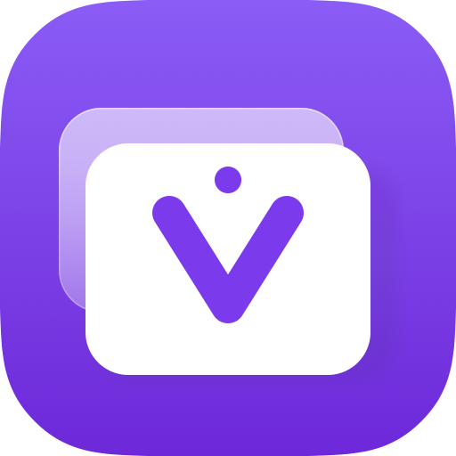

<p align="center">
  
</p>

<h1 align="center">VirtualVM</h1>

<p align="center">Native macOS app for running virtual machines, built with Swift and Apple's Virtualization framework.</p>

## Supported guests

- Mac
- Linux
- Windows (Coming soon)

## Top level features

- macOS guests that install and set themselves up
- Linux guests from a cloud image, ready in seconds
- `ssh <machine>` from your Mac
- Snapshots and instant duplicates
- Suspend and resume
- Shared folders and clipboard
- Port forwarding
- USB devices and disk images
- Lives in the menu bar
- `virtualvm` command-line tool

Windows guests are planned.

## Install

VirtualVM runs on macOS 26 or newer, on Apple silicon.

```bash
brew install --cask virtualvm-app/tap/virtualvm
```

Or download the DMG from the [latest release](https://github.com/virtualvm-app/virtualvm/releases/latest).

See [Getting started](docs/user-guide/getting-started.md) for your first virtual machine, the `virtualvm` command, and beta builds.

## Documentation

See [docs](https://virtualvm.app/docs).

## License

[Apache-2.0](LICENSE)
# VirtualVM
